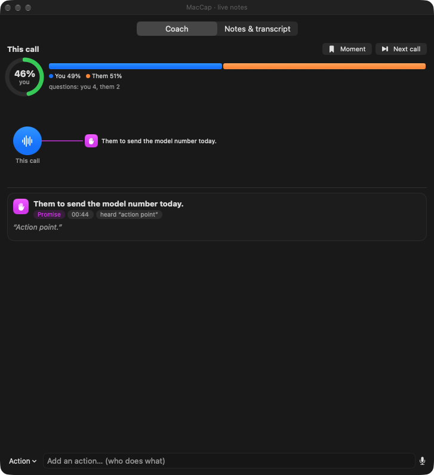
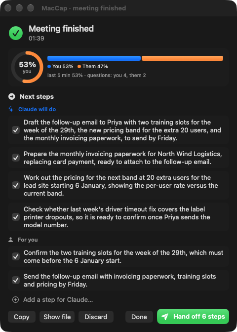
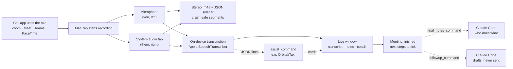
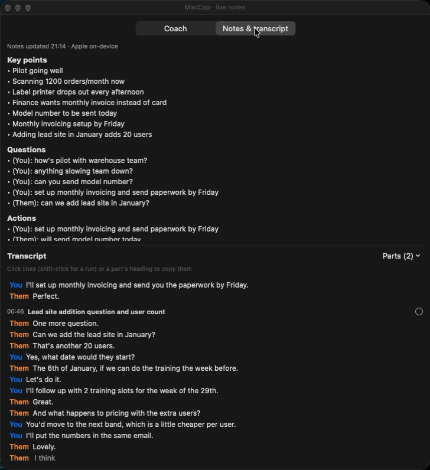

# MacCap

Call notes on your own Mac: no bot joins the call and nothing goes to the cloud.

Meeting recorders join your call as a guest, upload the audio and charge per
seat. MacCap is a menu-bar app that records the call where it already is, on
your Mac. While the call is on, it shows a live transcript, notes and your talk
time. When the call ends, it lists the next steps. With Claude Code, it splits
them into what Claude can draft for you and what only you can do.

> [!IMPORTANT]
> **Only record people who have said yes.** MacCap doesn't join the call, so
> nobody else gets a notice from it. Telling them is up to you. Ask everyone
> before you record. In many places recording a call without consent is against
> the law, and some places need every person on the call to agree. MacCap asks
> you to agree to this before it records anything. Its menu and its "Recording"
> notification copy a short consent message you can paste into the call's chat.
> See [Recording with permission](#recording-with-permission).

| During the call | When it ends, with Claude Code |
| --- | --- |
|  |  |

## What it does

- **Records calls on its own.** It starts when Zoom, Meet, Teams, Slack,
  FaceTime, WhatsApp, Webex or Discord uses the microphone, and also when you
  answer an iPhone call on the Mac. It stops 45 s after the call ends.
- **Keeps you and them apart.** Each call is one stereo `.m4a`: your microphone
  on the left channel and everyone else on the right. Transcripts know who is
  speaking without guessing.
- **Takes live notes on the Mac** (macOS 26+). Apple's on-device speech model
  writes the transcript, and an on-device model (or your own local LLM) writes
  the key points, questions and actions every minute.
- **Coaches you.** It shows your share of the talking, the questions each side
  asked, and a nudge when you've talked for too long.
- **Hands off the follow-ups.** When the call ends you get next steps to tick.
  With Claude Code they split into what Claude can draft and what only you can
  do. **Hand off** writes the drafts (emails, messages, outlines) into one file.
  Nothing is sent.
- **Plugs into your own tools.** Any program can follow the call as JSON lines
  and send cards back, for example who someone is, from your CRM.
  [Orbital/Taxi](integrations/orbital-taxi/) is one example.

## Try it without a call

Nobody needs to be recorded to see it work. The demo plays a made-up call
between "you" and Priya from a made-up company into the real windows, using
your Mac's built-in voices:

```bash
python3 scripts/demo-call.py                              # writes demo-call.m4a (90 s)
build/MacCap.app/Contents/MacOS/MacCap demo demo-call.m4a # live window, then meeting finished
```

The demo records nothing and saves nothing to your recordings folder.
`--speed 2` plays it twice as fast. This is that call:


## Install

You need an Apple silicon Mac with macOS 15 or later (macOS 26 for live notes
and the demo).

- **Download:** [the latest release](https://github.com/jhammant/maccap/releases/latest)
  has `MacCap-<version>.dmg`, signed with a Developer ID and notarized by Apple.
  Drag MacCap to Applications, then `brew install ffmpeg`.
- **Homebrew:** `brew trust jhammant/tap && brew install --cask jhammant/tap/maccap` (brings ffmpeg too).

### Build from source

You also need the Xcode command-line tools (`xcode-select --install`) and
ffmpeg (`brew install ffmpeg`).

```bash
git clone https://github.com/jhammant/maccap.git && cd maccap
./build.sh test       # build, then run the self-tests (no microphone needed)
./build.sh install    # copy to /Applications/MacCap.app
open /Applications/MacCap.app
```

macOS ties the Microphone and System Audio Recording permissions to the app's
signature. Set `MACCAP_SIGN_IDENTITY` to your signing identity (in your
environment or in an uncommitted `build.local.env`) and you only click Allow
once. Ad-hoc builds ask again after every rebuild. `MACCAP_BUNDLE_ID` changes
the bundle ID (default `io.maccap.MacCap`).

## Recording with permission

MacCap records two things: what your microphone hears and what your Mac
plays. Nothing joins the call, so the other people won't see a recording
notice unless you give them one.

- **At first launch** MacCap asks you to agree to record only people who have
  said yes. Until you agree it records nothing: no automatic recordings, and
  **Start recording now** asks first.
- **Copy consent message** (in the menu, and the button on the "Recording"
  notification) puts this on the clipboard for the call's chat: *"Before we
  start: I'd like to record this call so I can take notes. The recording stays
  on my Mac. Is everyone OK with that?"* Set your own with `consent_message` in
  `config.json`.
- **If someone says no:** **Stop and skip this call** stops recording. The
  audio so far goes to `audio/skipped/`, so delete it there.
  **Pause auto-record** stops automatic recording for calls you shouldn't
  record.
- **Recordings stay on your Mac** under `~/.maccap`, readable only by you.
  MacCap never uploads them. Claude Code, an assist or a notes endpoint only
  get what you configure them to get.
- **Screen sharing:** MacCap's windows ask to be left out of screenshots and
  shared screens. Not every app honours that, so share one window rather than
  your whole screen until you've checked yours.

The law differs from place to place, and when a call crosses borders it can
depend on where each person is. If you're not sure, ask everyone, every time.

## How it works



### Why two channels

Keeping you and them apart makes speaker labelling much easier: the left
channel is always you, so a diarizer only has to separate the other side.
Both channels share one host-time timeline, so they stay aligned for hours.

### How it captures

- **System audio:** a Core Audio process tap (macOS 14.2+) behind a private,
  tap-only aggregate device. It hears audio that ScreenCaptureKit cannot, such
  as FaceTime (`avconferenced`) and iPhone calls (`callservicesd`).
- **Microphone:** AVAudioEngine on the default input, downmixed to mono.
- **Crash-safe:** while recording, each side is written as AAC ADTS segments,
  which survive a crash or power loss. On the next launch, unfinished
  sessions are finalized automatically.
- **Safeguards:**
  - **AirPods:** the sample rate is read live, and checked against the real
    frame rate every 10 s. This catches a Bluetooth headset switching to
    16 kHz mid-call.
  - **Denied permission:** if the other side stays silent for about a minute
    while you are talking, MacCap tells you. A denied System Audio permission
    records silence rather than failing, so this is the only sign of it.

## Use

Open `MacCap.app`. It sits in the menu bar and:

- starts recording 4 s after a call app starts using the microphone, and
  stops 45 s after the call ends
- offers **Start recording now** for anything else (manual recordings never
  stop on their own)
- offers **Stop and skip this call**, which keeps the audio in `audio/skipped/`
  but leaves it out of the main folder
- offers **Copy consent message**, **Pause auto-record**, **Start at login**
  and **Open recordings folder**

The first recording asks for **Microphone** and **System Audio Recording**
access. Grant both to MacCap itself. If you run it from a terminal, macOS asks
on behalf of the terminal instead, so always go through the app bundle:

```bash
open -W -n -a MacCap.app --args record --seconds 20   # test recording
MacCap.app/Contents/MacOS/MacCap callers               # who is using audio now
MacCap.app/Contents/MacOS/MacCap finalize-pending      # save unfinished sessions
```

## With Claude Code

[`integrations/claude-code`](integrations/claude-code/) has one script for
both after-call steps. Add this to `~/.maccap/config.json`, changing the path
to where you cloned MacCap:

```json
{
  "final_notes_command": ["/usr/bin/python3", "/path/to/maccap/integrations/claude-code/maccap_claude.py", "final-notes"],
  "followup_command": ["/usr/bin/python3", "/path/to/maccap/integrations/claude-code/maccap_claude.py", "follow-up"]
}
```

- **When the call ends,** Claude reads the whole transcript and rewrites the
  next steps: up to four it can do (each one a draft for you to approve), up
  to two only you can do, and what the other side promised.
- **Hand off** sends the ticked steps back to Claude, which writes each draft
  into one Markdown file under `~/.maccap/follow-ups/`. The window shows
  "4 drafts ready" with an Open link.

Claude runs with `claude -p` and no tools, so it can only write text: it
can't send, post or change anything. You need Claude Code installed and logged
in. Set `MACCAP_CLAUDE_MODEL` to use a model other than Sonnet.

## With Orbital/Taxi

[`integrations/orbital-taxi`](integrations/orbital-taxi/) is a call assist
that looks up the people and companies said on the call in
[Orbital](https://orbitalhq.com), through its Taxi semantic layer, and shows
them as cards while you talk. The lookups are TaxiQL templates in a config
file, so they follow your own schema, whether the facts live in a CRM, a
database or an API:

```text
"…Priya Shah from Northwind Logistics…"  →  find { Person(PersonName == "Priya Shah") }   →  person card
                                         →  find { Company(CompanyName == "Northwind…") } →  company card
```

It's one Python file with no dependencies and no language model, so the same
call always gives the same cards. Its README covers setup and adapting the
templates.

## Live notes



On macOS 26 or later, a small floating window opens while a call is
recorded. It shows a live transcript (You = your microphone, Them = the call)
and, every minute, notes in three parts: key points, questions, and actions
(who promised what). When the call ends the notes are saved next to the
recording as `<name>.notes.md`, with the transcript under them.

- **Transcription:** Apple's on-device SpeechTranscriber, one per side.
  Nothing is sent anywhere. The speech model for your language downloads once
  if it isn't installed.
- **Echo:** on a speakerphone your microphone also hears the call. A line from
  your side that repeats what the call side said at the same moment is left
  out.
- **Notes model:** Apple's on-device model by default (no setup; it sees the
  most recent ~1,500 words). For better notes, point `notes_model_url` at any
  OpenAI-compatible endpoint, such as LM Studio or Ollama on your Mac. For a
  local reasoning model (Qwen 3), MacCap turns thinking off so updates take
  seconds, not minutes.
- **Parts of the call:** the same model splits the transcript into parts as
  the call goes ("Introductions", "Volumes and pricing", "Next steps"), shown
  as headings in the transcript, in the **Parts** menu to jump to one, and in
  the saved transcript. Only the part still open is looked at again, so the
  parts already closed never move and a long call costs no more per update.
- **Picking lines:** click lines in the transcript (shift-click for a run) or
  a part's heading to pick the whole part. With a call assist, **Help with
  these** or **Ask about these lines…** sends them (and the whole call as
  background) and the answer comes up in the Assist tab; without one, Copy.
- **The window:** menu → **Show live notes** while recording. Untick **Open
  live notes when recording** to keep it closed. It asks screen sharing to
  leave it out, but not every app honours that, so share a window rather than
  your whole screen until you have checked yours.
- **Try it without a call:** `MacCap demo FILE.m4a` (see
  [Try it without a call](#try-it-without-a-call)). `MacCap notes FILE.m4a`
  replays a recording through the same pipeline and prints the transcript and
  notes, and `record --seconds N --notes` takes live notes during a test
  recording.

If live notes fail, the window and the log say why. The recording carries on
regardless.

Notes only grow during a call: each update is merged into what is there, so
an action noted early stays in the list. With `notes_model_url` set, Apple's
model answers any update that endpoint can't (LM Studio not running).

## Moments, actions and the next call

- **Moment** (button or Control-Option-M): the last minute or so becomes one
  line (who does what, by when) from the notes model, as a card and a ticked
  next step. Saying a phrase like "action point", "I'll follow up" or "I'll
  send you" marks one by itself, unticked (`moment_phrases`; `[]` turns it off).
- **Typed:** the box at the bottom adds an Action or a Note, or (with an
  assist) asks it a question.
- **Said:** Control-Option-A (or the mic button), say the action, press it
  again. MacCap hears your microphone directly, so mute yourself in the call
  app first if the others shouldn't hear it.
- **Next call** (button, menu or Control-Option-N): saves this call and starts
  recording the next at once, for back-to-back calls in the same app. Its
  meeting-finished window waits until the next call ends. **Stop recording**
  now stays stopped until the call app lets go of the mic.

Cards open on a click when they have more to show (`detail`, a long `body`,
a `link`); a click on the map opens its card.

## Coach

The window's **Coach** tab shows who has done the talking: your share as a
ring (green while balanced, orange, then red past the limit), everyone as one
bar, the questions each side asked and your longest unbroken stretch. A short
"yes, go on" from them doesn't end your turn; silence does. It is measured
from the transcribed lines, so it is a guide, not a stopwatch.

A nudge appears as a card when you have talked for 90 s without a break
(`coach_monologue_seconds`), done 65% of the last five minutes' talking
(`coach_talk_share`), or asked nothing for eight minutes. Each nudge shows at
most every five minutes and never two within two minutes. `"coach": false`
turns it off. Talk time is saved with the notes.

## Call assist

Point `assist_command` at a program (absolute path, then its arguments) and it
follows the call: the Coach tab becomes **Assist**, with cards it sends (who
someone is, an answer, something to watch for), a map of what the call brought
up, a **Help me answer** button, a question box, and Control-Option-H from any
app (`"assist_hotkey": false` turns that off). MacCap knows nothing about
where cards come from; the program gets the call as JSON lines on stdin and
answers on stdout:

| MacCap sends | Fields |
|---|---|
| `start` | `v` (1), `started_at`, `session_dir`, `apps` |
| `line` | `stem` (`mic` or `system`), `speaker`, `text`, `start`, `end` (seconds from the start) |
| `ask` | `id`, `question`, `at`, `transcript` (the call so far, so it can be asked about anything said), `topics`; `focus` (+ `part`) when it is about lines you picked; `follows` + `thread` when it follows up an answer |
| `help` | `id`, `at`, `transcript` (the call so far), `topics`, and `focus` + `part` when you picked lines (`part`: the title, if you picked a whole part) |
| `moment` | `id`, `at`, `transcript` (the last minute), `auto` (a phrase marked it) |
| `action` | `id`, `text`, `at` (one you typed or said) |
| `end` | (stdin then closes; 5 s to finish) |

| The program sends | Fields |
|---|---|
| `card` | `id`, `kind` (`brief`, `person`, `company`, `answer`, `watchout`, `commitment`, `question`, `screen`, `coach`, `note`), `title`, optional `chips`, `quote`, `body`, `detail` (shown when opened), `link` (an Open button), `source`, `at`, `state` (`looking`, `ready`, `failed`), `pinned`, `action` (`next_call` adds a Start next call button) |
| `remove` | `id` |
| `status` | `text` |
| `context` | `title`, `workspace` (shown at the top) |
| `speaker` | `stem`, `start`, `end`, `name`: who was talking then; the transcript uses the name |

`topics` is the parts of the call so far, `[{"start": 130.0, "title": "Priya's
volumes"}]`; `focus` is the picked lines as `[mm:ss] Who: words`.

Every answer card has a **Follow up** button. A follow-up is an `ask` with
`follows` (the id of the answer it follows) and `thread`, the questions and
answers so far in that thread, oldest first: `[{"question": "Ideas so far",
"answer": "…"}]`. If the first answer was about picked lines, so is the
follow-up (`focus` again). The card answering it is shown inside the first
answer's card, under the answers before it.

Sending a card with an `ask` or `help` request's `id` answers it. A card's
`body` and `detail` are Markdown (bullets, numbered lists, `###` headings,
quotes, code, **bold**, *italic*, links); answer cards are always shown whole,
other cards open on a click when they are long. Lines it
can't read are logged and skipped; if it stops, the call is still recorded.
Cards are saved with the notes. `MacCap notes FILE.m4a --help-me --ask "…"`
replays a recording through it (`--follow-up "…"` then follows that answer up).

[Speakers call assist](integrations/speakers/) names enrolled voices on the call side live and can chain an existing assist with `--then`.

## Meeting finished

When a call with live notes is saved, a window opens with how the talking went
and the next steps the notes found, all ticked: edit them, untick, add your
own. **Copy notes** puts a Markdown recap on the clipboard. Set
`followup_command` and **Hand off** sends the ticked steps to it: the meeting
as one JSON object on stdin (`type` `meeting_finished`, `title`,
`started_at`, `duration_seconds`, `apps`, `recording`, `notes_file`,
`key_points`, `open_questions`, `next_steps`, `talk`). The last line it prints
may be JSON `{"status": "...", "url": "..."}`; the window shows the status and
an Open link. `"meeting_finished": false` turns the window off.

Set `final_notes_command` and the window's next steps, key points and open
questions are rewritten from the whole call once it ends: the program gets
the same JSON with `type` `final_notes` and the full `transcript`, and prints
one JSON object:

```json
{
  "ai_steps": ["Draft the follow-up email to Priya with the pricing bands."],
  "your_steps": ["Confirm the two training slots."],
  "waiting_on": ["Priya will send the printer model."],
  "key_points": ["Volumes are up to 1,200 orders a month."],
  "open_questions": ["Does the lower rate apply to every user?"],
  "model": "Claude Code (sonnet)"
}
```

`ai_steps` show under **Claude will do** and `your_steps` under **For you**;
`waiting_on` is listed apart and never handed off. A reply with only
`next_steps` is read as your own steps. Steps you added during the call stay;
if you have already edited the list, the new steps are added unticked. If the
program fails or prints nothing, the live notes' steps are used.

## Files

Everything lives under `~/.maccap` (override with `MACCAP_HOME`). All files
are owner-only.

| Path | What |
| --- | --- |
| `audio/YYYYMMDD HHMMSS-<id>.m4a` | the stereo recording (Voice Memos naming) |
| `audio/…maccap.json` | sidecar: apps, channels, offsets, health, route |
| `audio/…notes.md` | live notes and transcript from the call (macOS 26+) |
| `sessions/<stamp>-<id>/` | raw ADTS segments and `session.json` (kept) |
| `config.json` | optional settings (below) |
| `maccap.log` | log |

`config.json` (every key optional):

```json
{
  "audio_dir": "~/Recordings/calls",
  "extra_allowlist": ["com.example.MyCallApp"],
  "start_after_seconds": 4,
  "stop_after_quiet_seconds": 45,
  "narrow_tap_to_call_apps": false,
  "ffmpeg_path": "/opt/homebrew/bin/ffmpeg",
  "live_notes": true,
  "live_notes_locale": "en_GB",
  "notes_interval_seconds": 60,
  "notes_model_url": "http://localhost:1234/v1",
  "notes_model": "qwen/qwen3.6-27b",
  "notes_model_api_key_env": "MY_NOTES_API_KEY",
  "coach_talk_share": 0.65,
  "coach_monologue_seconds": 90,
  "assist_command": ["/usr/local/bin/my-call-assist", "--verbose"],
  "followup_command": ["/usr/local/bin/my-follow-ups"],
  "final_notes_command": ["/usr/local/bin/my-final-notes"],
  "consent_message": "Mind if I record this call for my notes? It stays on my Mac."
}
```

`allowlist` replaces the built-in list of call apps; `extra_allowlist` adds to
it. Entries match a bundle-ID prefix or a process name.
`narrow_tap_to_call_apps` (macOS 26+) records only the call apps instead of all
system audio. It is off until it has been proven on real calls.

## Credits

The process tap, the shared stem timeline and the remote-silence detector are
adapted from [Minutes](https://github.com/silverstein/minutes) (MIT, © 2026 Mat
Silverstein). See `THIRD_PARTY_NOTICES.md`.

## License

MIT. See `LICENSE`.
